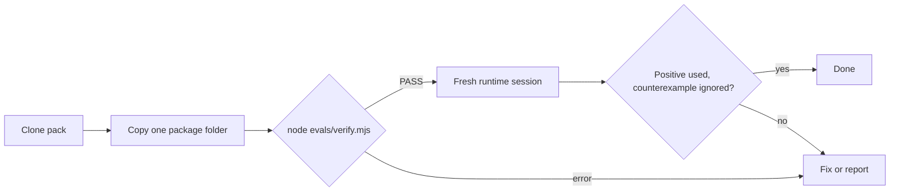

# WAVE agent pack — Install and verify (UX)

> Feature master: read this file first to understand how someone gets a skill from this pack into their project and
> checks it. Rules with REQ-IDs live in `logic/install-verify.md`.

## Purpose
- Problem: get one verified skill into a project without adopting anyone's control plane. Audience: a user of any of
  the five supported agent runtimes. Success signal: the package's verifier prints `PASS`, and a fresh runtime session
  uses the skill for a positive prompt and ignores it for a counterexample.

## Scope
- Included: the root `README.md` install and verify sections, each package README, `evals/verify.mjs`, the
  `Verify skills` GitHub workflow.
- Excluded: what each skill does once loaded (its own `SKILL.md`), and the private tool that writes
  `verification-receipt.json` (not shipped here).

## Current truth
- The user clones the collection (`git clone https://github.com/wblekhoa/wave-agent-pack.git`) and copies only the
  package they need, the whole folder:
  - Codex, Gemini CLI/Antigravity, or a configured OpenClaw/Hermes workspace: `.agents/skills/<skill-name>`
  - Claude Code: `.claude/skills/<skill-name>`
- The READMEs tell the user not to install over an existing skill of the same name unless its owner and rollback path
  are known, and to start a fresh runtime session afterwards.
- Verification is one command per package: `node skills/<skill-name>/evals/verify.mjs`. It prints one line ending in
  `PASS` or exits non-zero with the failing assertion. `audit-codex-storage` also needs `python3` (it runs the helper's
  unit tests and `--help`).
- Each package ships `verification-receipt.json`, bound by hash to the package files and to `SKILL.md`. The receipt
  says the package passed its declared checks at `evaluated_at`; it does not claim native auto-discovery.
- Every push to `main` and every pull request runs all package verifiers in GitHub Actions; the run fails if no
  verifier is found.

## Screens and states
| Screen | States | Entry | Exit / next |
|---|---|---|---|
| Root README | read | open the repo | pick a package |
| Terminal: copy | copied, name clash (user decides) | `cp -R wave-agent-pack/skills/<name> …` | verify |
| Terminal: verify | PASS line, assertion error | `node skills/<name>/evals/verify.mjs` | runtime check, or report the failure |
| Agent runtime | skill used, skill ignored | fresh session, positive and counterexample prompt | done |
| GitHub Actions | green, red | push / pull request | merge or fix |

## Flow

## Reading order
| File | Role |
|---|---|
| this file | current truth |
| `logic/install-verify.md` | rules + REQ-IDs (WAP-INST, WAP-VER) |
| `../../README.md` | the user-facing instructions this file describes |

## Change log
- 2026-10-11: created from the README, both package verifiers and `.github/workflows/verify.yml`.
